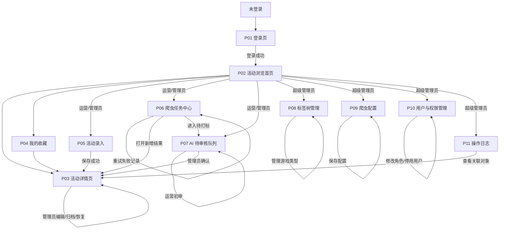
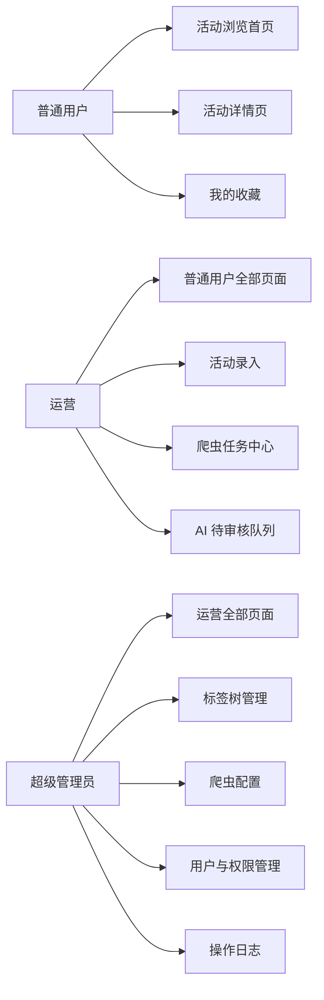
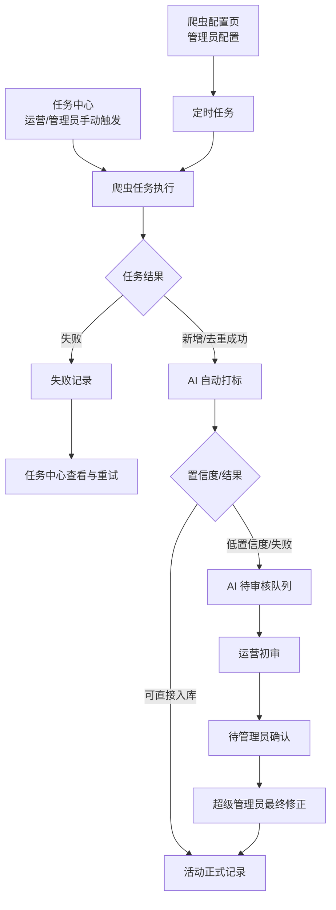

# 游戏活动参考库 页面结构规划 V1.0

- **依据**：游戏活动参考库 PRD V1.0
- **阶段**：MVP 页面结构规划
- **目标**：作为下一阶段可交互原型设计依据

## 1. MVP 页面总览

| 编号 | 页面 | 访问角色 | 主要用途 |
|---|---|---|---|
| P01 | 登录页 | 未登录用户 | 登录并进入系统 |
| P02 | 活动浏览首页 | 全部登录用户 | 标签筛选、浏览活动卡片、进入详情 |
| P03 | 活动详情页 | 全部登录用户 | 查看大图、完整字段、收藏、查看相关活动 |
| P04 | 我的收藏页 | 全部登录用户 | 查看个人收藏的活动 |
| P05 | 活动录入页 | 运营、超级管理员 | 单条新增、编辑回填和批量录入活动 |
| P06 | 爬虫任务中心 | 运营、超级管理员 | 查看任务、手动触发已配置爬虫、查看结果 |
| P07 | AI 待审核队列 | 运营、超级管理员 | 运营初审、管理员最终确认 AI 标签 |
| P08 | 标签树管理页 | 超级管理员 | 管理一级/二级/三级标签、标签说明、AI hints 和游戏类型 |
| P09 | 爬虫配置页 | 超级管理员 | 管理来源、规则、游戏范围和调度频率 |
| P10 | 用户与权限管理页 | 超级管理员 | 管理用户状态与角色 |
| P11 | 操作日志页 | 超级管理员 | 查询关键操作和审核记录 |

### 页面形态约定

- P02、P06、P07、P08、P09、P10、P11 采用后台工作台布局；
- P03 为独立详情页；
- P05 可作为独立页面，也可从 P02/P06 通过抽屉打开；原型阶段建议使用独立路由，便于表现表单状态；
- 删除确认、任务触发、失败重试、标签审核、标签迁移等使用弹窗或侧边抽屉，不拆成独立页面；
- P1 的时间线、游戏类型聚合、截图对比不纳入 MVP 页面结构。

## 2. 页面结构图

### 2.1 总体导航与角色入口



### 2.2 权限入口图



### 2.3 爬虫与审核主流程



## 3. 页面功能概览

| 页面 | 主要内容 | 关键操作 | 次级交互承载 |
|---|---|---|---|
| P01 登录页 | 登录方式、错误提示 | 登录、退出 | 登录失败提示使用页内反馈 |
| P02 活动浏览首页 | 标签树、筛选栏、排序、活动卡片网格 | 组合筛选、清空筛选、打开详情、收藏、进入录入/任务中心 | 标签展开折叠、筛选条件、收藏按钮使用局部交互 |
| P03 活动详情页 | 多图查看、活动字段、来源、相关活动 | 切换截图、收藏、打开来源、打开相关活动、管理员编辑/归档 | 图片切换、归档确认、相关活动使用页内组件/弹窗 |
| P04 我的收藏页 | 个人收藏卡片列表 | 查看详情、取消收藏、按最近收藏排序 | 空状态、取消收藏即时反馈 |
| P05 活动录入页 | 单条表单、批量录入页签、导入预览 | 保存单条、编辑回填、选择文件、导入有效记录、取消 | 标签选择器、导入预览表、问题记录提示、保存结果提示 |
| P06 爬虫任务中心 | 任务列表、执行进度、统计、失败 URL/原因 | 手动触发、查看详情、重试任务/单条记录、打开新增结果、进入待审核 | 触发任务弹窗、进度状态、任务详情抽屉、失败原因展开 |
| P07 AI 待审核队列 | 截图、活动字段、AI 候选标签、置信度 | 运营初审、补充/取消标签、提交管理员确认、管理员确认/修正 | 审核抽屉、标签选择器、退回原因弹窗 |
| P08 标签树管理页 | 标签树、游戏类型页签、标签说明、AI hints、关联活动数 | 新增一级/二级/三级标签、编辑、排序、合并、停用游戏类型 | 标签编辑抽屉、父级选择器、合并/迁移确认弹窗、类型管理页签 |
| P09 爬虫配置页 | 来源列表、规则、游戏范围、调度状态 | 新增/编辑/停用来源配置、设置频率、查看最近任务 | 配置编辑抽屉、停用确认弹窗 |
| P10 用户与权限管理页 | 用户列表、角色、状态、最近登录 | 新增用户、修改角色、停用/启用用户 | 用户编辑抽屉、停用确认弹窗 |
| P11 操作日志页 | 时间、操作者、角色、对象、动作、结果 | 按时间/操作者/动作筛选、查看详情 | 日志详情抽屉，不提供批量导出 |

## 4. 推荐导航结构

```text
顶部导航
├── 活动库
├── 我的收藏
├── 采集工作台（运营、超级管理员）
│   ├── 爬虫任务
│   └── AI 待审核
└── 管理设置（仅超级管理员）
    ├── 标签树
    ├── 爬虫配置
    ├── 用户与权限
    └── 操作日志

活动库页面内操作
├── 标签树筛选
├── 游戏类型筛选
├── 游戏名称搜索
├── 活动详情
└── 新增活动（运营、超级管理员）
```

## 5. 关键交互检查

### 5.1 核心流程覆盖

| 核心流程 | 页面覆盖 | 结果 |
|---|---|---|
| 登录并进入活动库 | P01 → P02 | 已覆盖 |
| 按活动形式筛选 | P02 | 已覆盖 |
| 组合筛选并浏览卡片 | P02 | 已覆盖 |
| 查看截图与完整字段 | P02 → P03 | 已覆盖 |
| 收藏和查看个人收藏 | P02/P03 → P04 | 已覆盖 |
| 手动录入活动 | P02/P06 → P05 | 已覆盖 |
| 运营手动触发爬虫 | P06 | 已覆盖 |
| 查看任务结果与失败记录 | P06 | 已覆盖 |
| 重试失败任务/记录 | P06 | 已覆盖 |
| 运营处理 AI 待打标记录 | P06 → P07 | 已覆盖 |
| 管理员最终确认标签 | P07 | 已覆盖 |
| 管理标签树 | P08 | 已覆盖 |
| 管理爬虫来源和频率 | P09 | 已覆盖 |
| 管理用户和角色 | P10 | 已覆盖 |
| 查询关键操作记录 | P11 | 已覆盖 |
| 归档与恢复活动 | P03 | 已覆盖，建议在详情页操作菜单中完成 |

### 5.2 权限检查

- 普通用户只显示活动库、详情和收藏入口；
- 运营增加活动录入、爬虫任务、AI 待审核入口；
- 运营不可看到或编辑爬虫配置、标签树、用户管理；
- 超级管理员可访问全部工作台；
- 运营 AI 初审完成后，必须进入“待管理员确认”，不能直接变为正式状态；
- 删除/归档、停用、合并、标签迁移等破坏性操作使用二次确认；
- 页面隐藏不替代后端权限校验，原型中需体现无权限状态或入口不可见。

### 5.3 可能遗漏或需要在原型中明确的交互

| 项目 | 建议处理 |
|---|---|
| 无筛选结果 | P02 增加空结果状态，并提供“清空筛选”入口 |
| 无收藏数据 | P04 增加空状态并返回活动库 |
| 爬虫任务执行中 | P06 展示进行中状态、进度和当前阶段，禁用同范围重复触发 |
| 任务部分失败 | P06 同时展示成功、重复、失败和待打标数量，并展开失败 URL/原因 |
| 批量录入文件 | P05 展示预览、有效记录和问题记录，只允许导入有效记录 |
| 活动编辑回填 | P03 → P05 回填原字段、标签和游戏类型，保存后返回 P03 |
| 游戏类型停用 | P08 停用后不出现在新录入和筛选选项，历史活动仍显示原类型 |
| AI 审核退回 | P07 需要填写退回原因，状态回到待处理 |
| 标签删除 | P08 必须先迁移关联活动，不能直接删除 |
| 活动归档恢复 | P03 使用操作菜单和确认弹窗，恢复入口仅管理员可见 |
| 来源 URL 失效 | P03 展示链接异常提示，但不影响截图和记录浏览 |
| 上传截图失败 | P05 保留已填写字段，提示失败原因并允许重试 |
| 越权访问 | 所有受限页面提供无权限状态，不仅依赖前端隐藏 |

## 6. 页面结构结论

推荐采用 **11 个主要页面 + 弹窗/抽屉承载次级操作** 的 MVP 结构：

- 浏览链路集中在 P02、P03、P04；
- 运营采集链路集中在 P05、P06、P07；
- 管理配置集中在 P08、P09、P10、P11；
- 没有发现阻塞性页面缺失；
- 核心业务流程、角色入口和权限边界均有对应页面承载；
- 可以进入下一阶段的可交互原型设计。

下一阶段原型应优先验证 3 条主线：

1. 普通用户：筛选 → 浏览 → 详情 → 收藏；
2. 运营：触发爬虫 → 查看结果 → 处理失败/AI 待审核；
3. 超级管理员：最终审核 → 管理标签/爬虫配置/用户。
